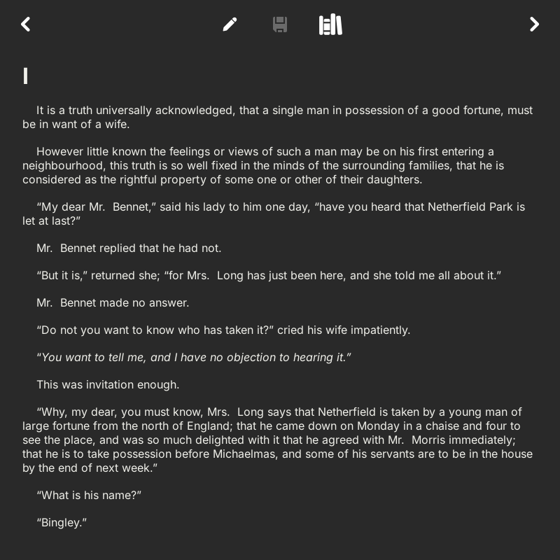
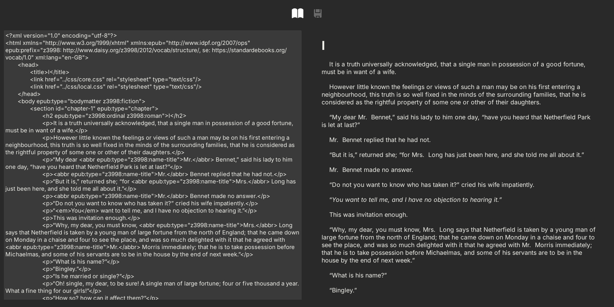

# EbookReader

A desktop e-book reader and editor for Linux, written in Rust with the
[Druid](https://github.com/linebender/druid) GUI toolkit.

<p>
  
  
</p>
<p>
  
</p>

## Features

- Keep a library of your EPUB files.
- Read a book chapter by chapter, including its illustrations.
- Edit the source of a chapter with a live preview, and save the changes back
  to the EPUB file.
- Move between the paper and the digital edition: photograph a page of the
  printed book to jump to the same point in the e-book, or find which printed
  page matches the point you are reading. Matching uses OCR (Tesseract) and is
  accurate to within a few pages.

## Build and run

Tested on Ubuntu 24.04 with stable Rust. Install the system libraries for the
GUI (GTK) and for OCR (Tesseract, Leptonica), plus the language data for the
books you want to align:

```bash
sudo apt install libgtk-3-dev libleptonica-dev libtesseract-dev clang \
                 tesseract-ocr-eng tesseract-ocr-ita
```

Then run it from the repository root:

```bash
cargo run --release
```

Import books with the + button.

---

Developed as a group project for the System Programming course at
Politecnico di Torino (2022–23).